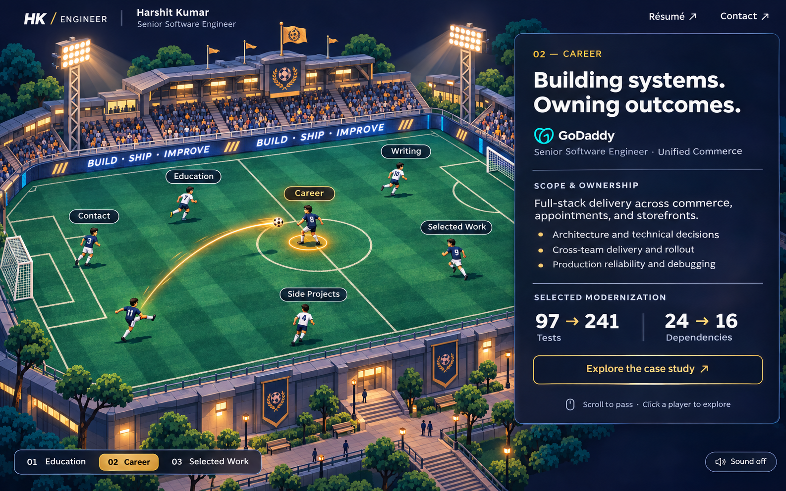

# Football portfolio implementation blueprint

## Experience and visual direction

Build a generic engineering portfolio with an illustrated night stadium, animated players, and a readable experience panel. The actual title remains Senior Software Engineer. Demonstrate staff-level scope through architectural judgment, cross-team influence, delivery, and measurable results.



Visual mockups are exploratory references, and all copy and metrics are placeholders until verified. Additional layout and animation suggestions describe intended behavior rather than completed assets or a working demo. The reference is an AI-generated composition. It includes sample career copy and metrics that need validation before publication. Its extra unlabeled player and painted labels are illustrative. The implementation uses exactly six interactive players.

## Background-first approach

Use a high-quality painted stadium as the base and overlay React components. This provides rich visual detail with a manageable implementation cost. The current full screenshot is the design reference. Production requires a clean stadium plate with the UI, players, labels, ball, selection rings, and pass trail removed. Otherwise baked elements would duplicate the interactive components.

Create the clean plate at approximately 2400 × 1600 with an unobstructed field. Preserve the illustrated perspective, grass, stands, static lighting, and buildings. Export AVIF and WebP variants with a fallback. Make separate transparent sprites for players and optional foreground railings. Keep all text in HTML. Create a separate mobile composition only if the original cannot retain readable player spacing.

| Asset | Requirements | Purpose |
| --- | --- | --- |
| stadium-base | 3:2 source, desktop and smaller responsive exports | Grass, stands, buildings, static shadows |
| player atlas | Transparent, consistent foot anchor, idle/call/kick/receive frames, left/right orientation | Six reusable player instances |
| ball | Transparent texture or small SVG | Rotation and altitude illusion |
| foreground | Optional transparent railing at same dimensions as base | Occlusion and depth |
| sound | Optional licensed short kick and receive samples | Enabled only after explicit sound toggle |

Generate or commission original artwork. Record source and usage rights with assets. Treat source PNG as design documentation, and optimized clean artwork as runtime assets.

## Proposed stack and files

Use React, TypeScript, Vite, CSS Modules, SVG for the trajectory, and a single requestAnimationFrame controller for ball movement. Keep animation dependencies optional until the first pass is evaluated. Portfolio data lives in typed objects or Markdown and is independent of scene positions.

Suggested folders are src/components, src/scene, src/content, src/styles, public/art, and public/audio. Put the state machine in src/scene/usePassController.ts, geometry in src/scene/passGeometry.ts, and player coordinates in src/scene/formation.ts. Add prerendering for public content pages before release so search engines and link previews can read the portfolio.

## Component responsibilities and CSS

| Component | Responsibility and interaction | CSS and rendering |
| --- | --- | --- |
| PortfolioShell | Own selected section and shared navigation | Dark page, desktop grid, minimum 100svh, overflow-x clip |
| SiteHeader | Name, true title, résumé, and Plain view link | Overlay at the top of the pitch, outside world transforms, flex wrap, high z-index |
| PitchNavigation | One primary navigation system for all six sections | Semantic nav in the pitch top bar, aria-current, 44px targets |
| ProgressStrip | Six noninteractive steps matching the six players | Ordered list beneath scene, active step highlighted, no duplicate menu |
| PlainView | Full résumé and project content with ordinary links | Single readable column, native scrolling, stable section anchors |
| StadiumViewport | Reserve image dimensions and clip the moving world | position relative, isolation isolate, aspect-ratio 3/2, overflow hidden |
| StadiumWorld | Shared coordinate space for background and all scene objects | position absolute, inset 0, transform-origin center; camera transform applied here only |
| StadiumBackground | Responsive picture element | width and height 100%, display block, exact shared aspect ratio |
| AtmosphereLayer | Very subtle glow and optional light pulses | pointer-events none, low opacity; static when reduced motion enabled |
| PlayerButton | Accessible section target and foot position | Absolute percentage coordinates, translate(-50%,-100%), minimum 44px target |
| PlayerSprite | Call, kick, receive, idle visual | Sprite atlas with steps() frames; independent inner wrapper for rotation/scale |
| PlayerLabel | Readable section title and active state | Dark pill, 12–14px minimum, high contrast, focus-visible outline |
| SelectionRing | Identify current possession | Ellipse anchored at foot, amber border and restrained shadow |
| BallLayer | Ball, shadow, short trail | Absolute overlay with pointer-events none; transform updates each frame |
| PassTrail | Show a short fading segment of flight | SVG using the same viewBox as the world, stroke with rounded caps |
| ContentPanel | Section label, headline, one verified metric and one CTA | Fixed 360px desktop width, solid navy, 24px padding, 16px entrance translation |
| MetricValue | Count once per section per session | Tabular numerals, stable reserved width, final accessible value |
| CareerSection | Role timeline, scope, achievements, case-study links | Semantic headings and ordered list; dates remain text |
| EducationSection | Degree, institution, dates, relevant work | Compact readable rows, no fabricated fields |
| SelectedWorkSection | Three substantial case-study previews | Problem, ownership, outcome, descriptive links |
| SideProjectsSection | Independent builds and demos | Thumbnail, concise description, real links |
| WritingSection | Articles, talks, system design explainers | Title, topic, date, and destination |
| ContactSection | Verified email, LinkedIn, GitHub, résumé | Real anchors and buttons with accessible names |
| CaseStudyPage | Full problem, constraints, options, decision, rollout, results | Dedicated URL, reading layout, back link restores section |
| SoundToggle | Persist explicit audio preference | Visible text label, aria-pressed, minimum 44px target |

## CSS foundation

```css
:root {
  --page: #080f22;
  --panel: #101a30;
  --text: #f5f7fc;
  --muted: #bbc5d8;
  --accent: #ffc653;
  --border: #425674;
}
.portfolio {
  display: grid;
  grid-template-columns: minmax(0, 1fr) 360px;
  gap: clamp(16px, 2vw, 32px);
  color: var(--text);
  background: var(--page);
}
.stage {
  position: sticky;
  top: 88px;
  align-self: start;
  aspect-ratio: 3 / 2;
  overflow: hidden;
  isolation: isolate;
}
.world { position: absolute; inset: 0; }
.player {
  position: absolute;
  left: calc(var(--x) * 1%);
  top: calc(var(--y) * 1%);
  transform: translate(-50%, -100%);
  min-width: 44px;
  min-height: 44px;
}
.panel {
  min-width: 0;
  background: var(--panel);
  border: 1px solid var(--border);
  border-radius: 20px;
  padding: clamp(24px, 3vw, 36px);
  line-height: 1.6;
}
button:focus-visible, a:focus-visible {
  outline: 3px solid var(--accent);
  outline-offset: 4px;
}
@media (max-width: 900px) {
  .portfolio { grid-template-columns: minmax(0, 1fr); }
  .stage { position: relative; top: auto; }
  .panel { border-radius: 16px; }
}
```

These are starting values to refine against the artwork. Keep content panels outside camera transforms. Use separate wrappers for player positioning and sprite motion so animations cannot overwrite the positioning transform. Apply will-change only while objects animate. Use 16px or larger body text and restrained heading sizes.

## Interaction polish and CSS details

The six players are optional shortcuts into the same navigation action and section state as the pitch top bar. Plain view is always visible and preserves the current section when switching modes. Remember the mode preference where storage is available. Full case studies carry staff-level evidence beyond the compact panel.

Dim only the decorative stadium layer while the panel is open, starting with brightness(.75) and saturate(.8). Keep players, navigation, labels, and the ball readable. Transition these values over 200ms and check performance on mobile.

Hover and keyboard focus lift an inner sprite wrapper 4px, brighten the label, and reveal a soft ground ring. Show a short preview such as “Career · GoDaddy”. Keep the foot anchor and hit target fixed. Touch does not depend on hover.

Panel entrance uses opacity and translateX(16px), with headline, metric, and CTA delays of 0, 60, and 120ms. Trigger this on scene entrance. Later section changes use the 70% pass crossfade and the same short stagger. Hidden outgoing content is inert and excluded from the accessibility tree. Retain a stable panel height to avoid layout jumps.

Count up only suitable verified numeric metrics once per section per session. Store visited metric IDs. Use a short 400ms animation with tabular numerals, and expose the final value to assistive technology without live announcements per frame. Render complex ranges and nonnumeric highlights directly.

Idle life uses CSS loops for slow crowd shimmer, a 1–2px active-player bob, and very low-amplitude floodlight variation. Keep light changes slow and non-flashing. Add a document visibility class to pause animation-play-state when the tab is hidden and pause offscreen scenes. Reduced motion disables these loops.

A first-visit kickoff lasts at most two seconds. The ball rolls to centre, then the selected player gains possession and the initial panel opens. Keep a visible Skip intro button and navigation available throughout. Any navigation cancels the intro and settles at the requested player. Record introSeen only on completion or skip. Skip automatically for reduced motion, Plain view, or a direct section link. If storage fails, default to skipping. Provide a development-only duration control and reduced-motion simulation for review.

## Coordinate alignment and layering

Choose one canonical world size, such as 2400 × 1600. Store foot positions as normalized coordinates from 0 to 1, calibrated against the final clean artwork. HTML, SVG viewBox, ball path, shadows, and foreground share that coordinate system.

Maintain the complete image aspect ratio inside the stage. A separate cover background would crop differently and misalign players. If cropping becomes necessary, compute one shared scale and translation for every world layer. Use ResizeObserver to update the world-to-screen scale. Store the pass in world units so resizing mid-flight preserves its trajectory.

Layer order starts with background, light overlays, ground shadows, players and ball, foreground occluders, then labels. Sort grounded objects by foot y where overlap is possible. Ball elevation affects visual height, while depth ordering uses its ground position. The content panel and header live above the scene in their own stacking context.

## Passing animation

Use idle → windup → flight → receive → idle. Initial possession is Career. Education remains directly accessible. Suggested sequence is Education, Career, Selected Work, Side Projects, Writing, Contact.

Ball travel takes 700–900ms, default 800ms, with ease-in-out progress. Keep windup and receive poses brief and overlapping the transition. Crossfade panel content at 70% of flight and pulse the receiving ring on arrival. Apply eased progress consistently to both ground position and elevation. Use one small settle movement. Each player turns toward the target and uses the appropriate sprite frames.

For normalized time t, define ground position with a quadratic Bézier curve between the source foot and target foot. A slightly offset midpoint creates lateral curl. Let height h(t) = 4 × H × t × (1 − t). Render the ball at (groundX, groundY − h), and the shadow at (groundX, groundY). Increase shadow blur and lower its opacity with height. Apply subtle scale increase and ball rotation to suggest depth. Keep the bright trail short and fade it within about 150ms.

Camera motion should be limited to approximately 12px pan and 1.02 scale during a long pass, returning smoothly to rest. The same parent transform moves all world layers. Disable camera motion for reduced motion and narrow screens.

## State, scroll, and repeated input

Keep selectedSection, possessionSection, targetSection, phase, and latestPendingTarget explicit. A selection records the target immediately. Keep displayedSection separate and commit it at 70% of the pass, then crossfade the panel. The ring changes possession on reception. Announce the new section once through a polite live region.

Clicking the current target is a no-op. During flight, remember only the latest requested destination, finish reception, then pass onward. This avoids teleportation and unbounded queues. A new click supersedes passive scroll requests. Cancel animation frames and listeners on unmount. On tab visibility loss, settle at the requested section and clear pending animation.

Scene mode is a single fixed viewport: the header, pitch, navigation dock, and reading panel all fit the first fold at every screen size, and the document never scrolls. Wheel and touch scrolling do not trigger passes. Navigation is by clicking a player or using the dock. The panel shows a compact brief, an Expand control that opens the full details dialog, and a link-out at the bottom. Plain view and case studies use native document scrolling.

Support direct hashes such as #career, browser back/forward, and refresh. Initialize the ball at a deep-linked section. Keyboard activation uses the same navigation action. Arrow shortcuts may operate only inside focused scene navigation, never globally.

## Content and professional credibility

The compact scene panel links to full content through its single CTA. Full content must be reachable from Plain view and direct URLs. Use a meaningful factual highlight if a section has no suitable metric, especially Education and Contact. Career shows actual roles, dates, scope, and attributable achievements. Education shows verified institution and degree information. Selected Work spans backend, frontend, platform, and product delivery. Each case study explains context, constraints, personal contribution, alternatives, technical decisions, collaboration, rollout, results, and lessons.

Use the sample modernization metrics only after confirming the baseline, services, and measurement period. Gather education details, dates, public contact links, and résumé before launch. Public copy should use approved project descriptions and exclude internal credentials, private endpoints, and sensitive company details.

## Mobile, accessibility, and resilience

At narrow widths, show the pitch above content and provide persistent compact section navigation. Avoid a large sticky stadium that consumes the entire phone viewport. Player labels may shorten to Work and Projects while accessible names remain complete. Check the smallest target spacing at 360px.

With prefers-reduced-motion, settle possession immediately and use a plain 120ms content crossfade. Remove movement, count-up, stagger, trails, ring pulse, camera motion, and idle loops. The final metric is immediately available. Keyboard users can navigate every player and ordinary content link. Keep focus on the selected navigation button during section changes. Dedicated case-study routes set focus to their heading on navigation. Maintain contrast and avoid flashing lighting.

If artwork fails, retain text navigation and all content. If JavaScript fails, prerendered content and links remain useful. Pause decorative loops when offscreen. Audio defaults off and begins only after a user gesture.

## Performance targets and verification

Aim for a desktop stadium transfer below 700KB and a mobile variant below 300KB, subject to visual checks. Preload only the initial stadium, provide intrinsic dimensions, lazy-load secondary media, and subset fonts. Target LCP under 2.5 seconds and CLS below 0.1 on a representative mobile test. Measure animation frame time on a mid-range phone.

Verify click navigation, all directions of passing, rapid destination changes, resize during flight, deep links, history, keyboard operation, reduced motion, and WebGL failure. Verify that wheel input never changes section and that no viewport size produces document or panel overflow. Verify Plain view, all six progress steps, one-time count-up, intro skip and repeat visits, 70% panel commit, hidden-tab pause, and rapid clicks during kickoff. Inspect at 360, 390, 768, 1280, and 1440px. Check every label and foot anchor against the final artwork.

## Implementation order

1. Prepare clean stadium, player sprites, and verified content inputs.
2. Build responsive semantic content, header, section links, and static scene alignment.
3. Prototype one diagonal pass with shadow, sprite kick, first touch, and restrained camera motion.
4. Connect all six destinations through one state machine.
5. Add complete case studies, route restoration, mobile layout, and accessibility behavior.
6. Optimize assets and run the interaction and performance checks above.

Completion requires both a satisfying pass and readable, complete engineering evidence. This repository currently contains the concept and blueprint. Runtime artwork and the website will be created during implementation.
